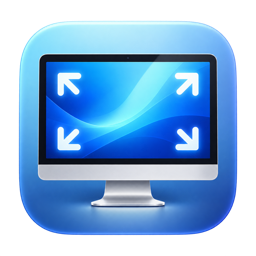
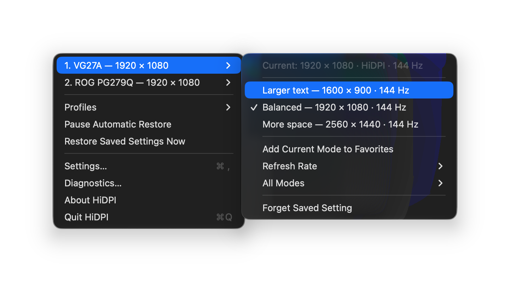
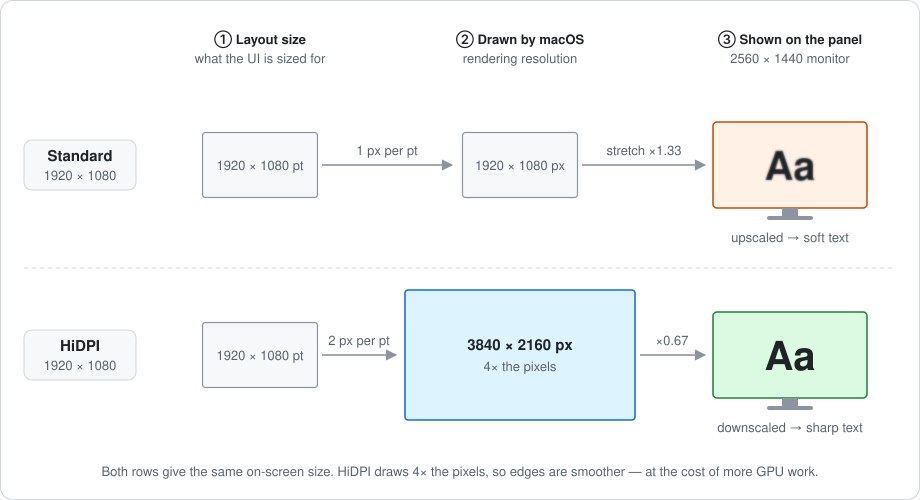
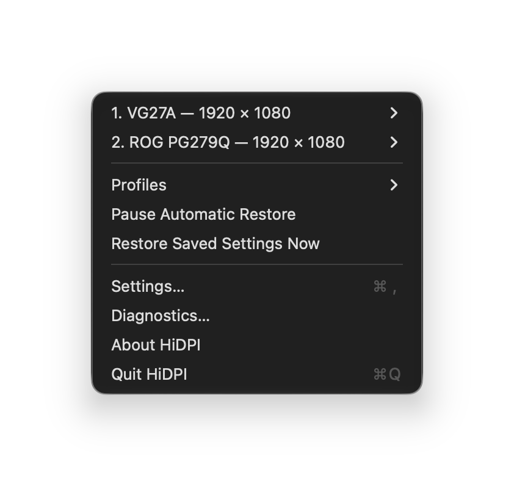
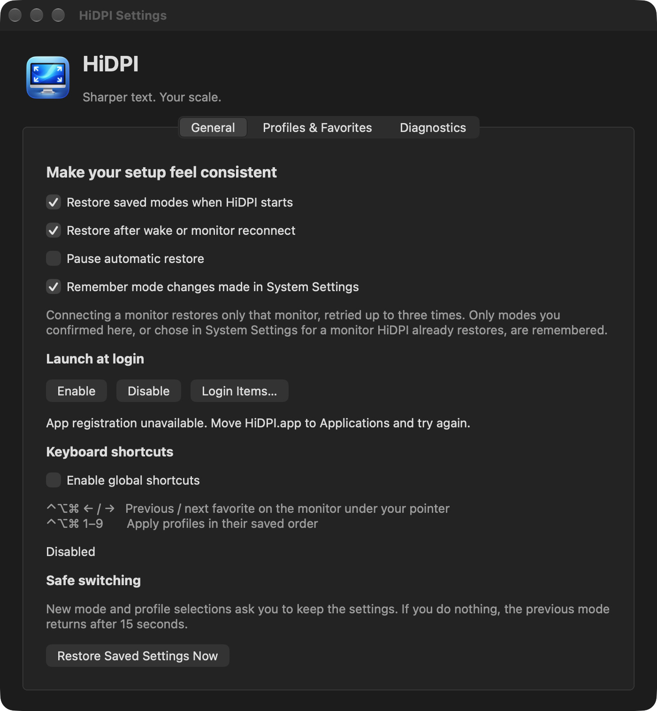
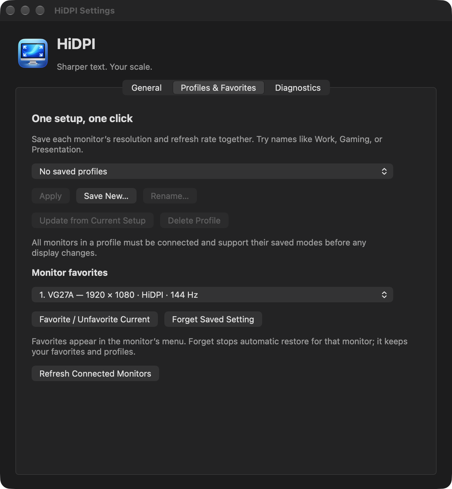
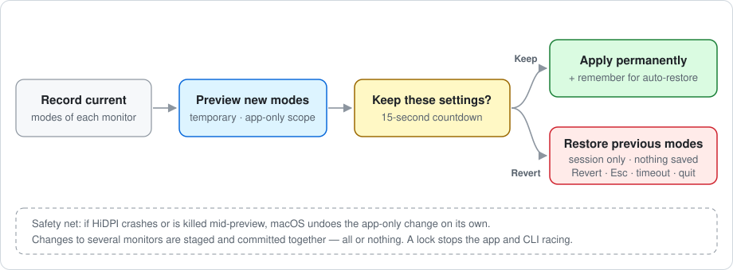
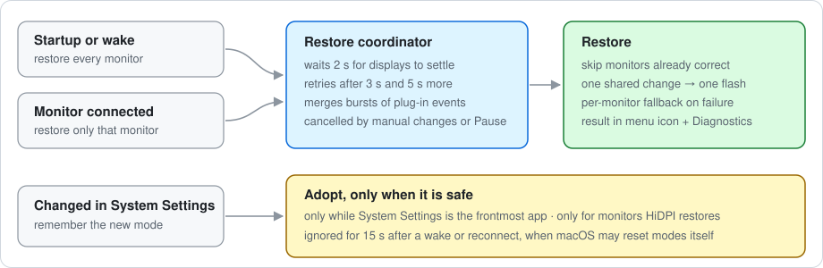
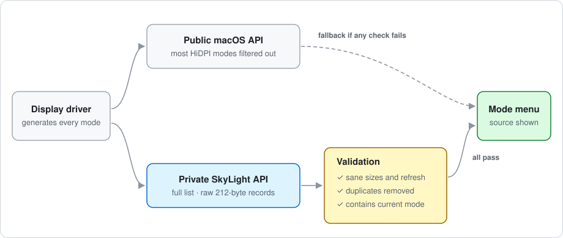

<div align="center">



# HiDPI

**Sharper text. Your scale.**

Unlock the HiDPI ("Retina") scaling modes macOS hides on external monitors —<br>
switch to them safely, save favorites and profiles, and keep them after sleep and reconnects.

[](https://github.com/Sigvarth1/hidpi/releases/latest)




</div>

---

## Contents

- [Why this exists](#why-this-exists)
- [Features](#features)
- [Install](#install)
- [Using the menu bar app](#using-the-menu-bar-app)
- [Safe switching](#safe-switching)
- [Favorites, profiles and shortcuts](#favorites-profiles-and-shortcuts)
- [Automatic restore](#automatic-restore)
- [Command-line tool](#command-line-tool)
- [How mode discovery works](#how-mode-discovery-works)
- [Legacy override cleanup](#legacy-override-cleanup)
- [Build from source](#build-from-source)
- [Project layout](#project-layout)
- [Limitations](#limitations)

## Why this exists

On a Retina display macOS draws everything with 2 × 2 pixels per point, which is why
text looks so crisp. On many external monitors, such as 1440p monitors at 24–27″,
macOS decides the screen isn't dense enough. **Most HiDPI modes are filtered out**
(on some macOS versions and monitors, all of them). What's left is mostly plain 1:1
modes, and any size other than native is stretched and soft.

The display driver still generates the full set. They're just filtered out before
apps and System Settings see them. HiDPI reads the driver's full list and lets you
pick from it.

<p align="center">
  
</p>

For example, **1920 × 1080 HiDPI** on a 2560 × 1440 monitor keeps the comfortable size
of 1080p but renders at 3840 × 2160, then scales down to the panel. You get the same
layout with much smoother text. The trade-off is extra GPU work.

> On a 27″ ASUS ROG PG279Q (2560 × 1440) under macOS 27, the public macOS API
> offers 25 HiDPI modes. The driver list read by HiDPI has 78, out of 150 modes in total.

## Features

| | |
|---|---|
| 🖥️ **Per-monitor menu** | Three suggested scales (Larger text / Balanced / More space), refresh rates, and every available mode |
| 🛟 **Safe switching** | Every change is a preview with a 15-second "Keep these settings?" countdown; doing nothing reverts |
| ⭐ **Favorites** | Save the modes you use per monitor and cycle through them with a shortcut |
| 🗂️ **Profiles** | Save every monitor's mode as one named setup ("Work", "Gaming") and apply it in one click |
| 🔁 **Automatic restore** | Puts your modes back at startup, after sleep, and when a monitor reconnects |
| ⌨️ **Global shortcuts** | ⌃⌥⌘ ← / → for favorites, ⌃⌥⌘ 1–9 for profiles, with no Accessibility permission needed |
| 🧰 **CLI** | Every feature is also available from the terminal for scripts |
| 🔍 **Diagnostics** | A copyable report: modes, identities, where each mode list came from, last restore results |

Native Swift and AppKit, no third-party dependencies, no network access, no telemetry.

## Install

1. Download **`HiDPI-<version>.zip`** from the
   [latest release](https://github.com/Sigvarth1/hidpi/releases/latest) and unzip it.
2. Move **HiDPI.app** to **Applications**.
3. Open it. It lives in the menu bar (the display icon) and has no Dock icon.

> [!IMPORTANT]
> The app is **ad-hoc signed, not notarized** by Apple, so macOS blocks it the first
> time. After the warning, open **System Settings → Privacy & Security** and click
> **Open Anyway**. Or remove the download quarantine in Terminal:
>
> ```sh
> xattr -dr com.apple.quarantine /Applications/HiDPI.app
> ```
>
> You can check the download against `SHA256SUMS.txt` from the release with
> `shasum -a 256 HiDPI-*.zip`.

To start HiDPI at login, open **Settings → General → Launch at login → Enable**.
macOS may ask you to approve it in Login Items.

**CLI (optional):** download `hidpi-cli-<version>.zip`, unzip it, then:

```sh
xattr -d com.apple.quarantine hidpi
sudo install -m 755 hidpi /usr/local/bin/hidpi
```

The app and CLI share the same settings (the `local.hidpi` user-defaults domain).

## Using the menu bar app

<p align="center">
  
</p>

Each connected monitor has its own submenu:

- **Larger text · Balanced · More space.** Three HiDPI sizes chosen to match the
  monitor's aspect ratio, from the modes that are actually available. They are
  heuristics, not panel calibration.
- **Favorites.** Your saved modes for this monitor.
- **Add Current Mode to Favorites.**
- **Refresh Rate.** Changes the refresh rate and keeps the current size.
- **All Modes.** Every HiDPI and standard mode, grouped by size, with refresh-rate submenus.
- **Forget Saved Setting.** Stops restoring this monitor.

The menu bar icon shows a warning badge if an automatic restore needs attention.
**Restore Needs Attention…** in the menu explains what happened.

### Settings

<table>
  <tr>
    <td width="50%"></td>
    <td width="50%"></td>
  </tr>
  <tr>
    <td align="center"><b>General</b>: restore behaviour, login, shortcuts</td>
    <td align="center"><b>Profiles &amp; Favorites</b>: manage setups</td>
  </tr>
</table>

A third tab, **Diagnostics**, shows the full report. Use **Copy Report** to share it
when filing an issue. It includes monitor identities, so check it before posting.

## Safe switching

A wrong display mode can leave you with an unreadable screen, so no change is final
until you confirm it.

<p align="center">
  
</p>

- **Previews are temporary and tied to the HiDPI process.** If HiDPI crashes or is
  killed mid-preview, macOS reverts the change by itself.
- **Multi-monitor changes are all-or-nothing.** Every monitor is staged in one
  CoreGraphics transaction before anything is committed. Profiles are checked
  completely first; if any monitor or mode is missing, nothing changes.
- **Only Keep saves.** Reverting restores the previous modes for the current session
  and writes nothing.
- **Quitting, logging out or shutting down** during the countdown reverts the preview
  instead of blocking.
- **A process lock** stops the app and the CLI from changing displays at the same time.

## Favorites, profiles and shortcuts

**Favorites** are per-monitor lists of modes. Add the current mode from the monitor's
menu or from Settings.

**Profiles** store the resolution, rendering size and refresh rate of every connected
monitor under a name. You can apply, rename, update from the current setup, or delete
them in Settings. Profiles don't change arrangement, rotation or mirroring.

**Global shortcuts** are off by default. Enable them in **Settings → General**:

| Shortcut | Action |
|---|---|
| <kbd>⌃</kbd><kbd>⌥</kbd><kbd>⌘</kbd><kbd>←</kbd> | Previous favorite on the monitor under the pointer |
| <kbd>⌃</kbd><kbd>⌥</kbd><kbd>⌘</kbd><kbd>→</kbd> | Next favorite on the monitor under the pointer |
| <kbd>⌃</kbd><kbd>⌥</kbd><kbd>⌘</kbd><kbd>1</kbd> … <kbd>9</kbd> | Apply profiles in their saved order |

Shortcuts use registered system hotkeys and need no Accessibility or Input Monitoring
permission. Each one registers on its own, so if another app already uses one
combination, the rest still work and Settings names the one that failed. Shortcut
changes use the same confirmation countdown.

## Automatic restore

macOS sometimes drops these modes after sleep or when a monitor is reconnected.
While the app is running, it puts them back.

<p align="center">
  
</p>

- **Startup and wake** restore every monitor. **Connecting a monitor** restores only
  that monitor, so the others keep their modes.
- Restores wait about 2 seconds for displays to settle, retry after 3 and 5 more
  seconds, and merge bursts of plug-in events into one restore.
- Monitors that need a change switch together (one screen flash). If that fails,
  they switch one at a time.
- **Changes you make in System Settings are respected.** If you change a monitor that
  HiDPI already restores, HiDPI remembers the new mode, so the next wake doesn't undo
  your choice. This only happens while System Settings is the frontmost app, and not
  within 15 seconds of a wake or reconnect, when macOS may reset modes itself. You can
  turn it off in Settings.
- **Pause Automatic Restore** in the menu stops all of this. **Restore Saved Settings
  Now** always works.

### How monitors are recognised

A saved setting is tied to a monitor identity made of its vendor and product numbers
plus the system display UUID, or the hardware serial if there is no UUID. Two identical
monitors therefore keep separate settings. Some monitors report missing or duplicate
serials, and UUIDs can depend on the port. When two connected monitors end up with
the same identity, HiDPI refuses to guess: it skips them during automatic restore and
rejects manual multi-monitor changes. Diagnostics shows which source each identity
came from.

## Command-line tool

```sh
hidpi list                          # monitors, current modes, identities
hidpi modes 1                       # every mode for monitor 1 (→ marks the current one)
hidpi set 1 1920x1080               # preview, then type y + Return within 15 s to keep
hidpi set 1 "1920 × 1080"           # the size format printed by list/modes also works
hidpi set all 1920x1080 --hz 144    # pick a refresh rate
hidpi set 1 2560x1440 --lowdpi      # standard (1×) instead of HiDPI
hidpi set 1 1920x1080 --yes         # keep without asking (for scripts)
hidpi restore                       # apply remembered modes now; reports per monitor
hidpi forget 1                      # stop restoring monitor 1
hidpi status                        # diagnostics report

hidpi favorite toggle 1             # add/remove the current mode as a favorite
hidpi favorite list all
hidpi profile save "Work"
hidpi profile list
hidpi profile apply "Work"          # preview the whole profile
hidpi profile update "Work"         # replace with the current setup
hidpi profile rename "Work" "Office"
hidpi profile delete "Office"
```

You can select a monitor by its index from `list`, its display ID, its stable
identity, an unambiguous part of its name, `main`, or `all`. If no terminal is
attached, the CLI reverts immediately unless you pass `--yes`. Invalid sizes,
non-finite refresh rates and ambiguous names are rejected before any display is
touched. `--help` and `--version` work without a display session.

## How mode discovery works

<p align="center">
  
</p>

At runtime, HiDPI loads three undocumented functions from Apple's private
**SkyLight** framework: one to count modes, one to describe a mode, and one to
switch modes. Each mode comes back as a raw 212-byte record. HiDPI reads the
size, pixel size, refresh rate and flags from fixed positions in it.

Those positions were found by reverse engineering, and a macOS update could move
them. So the private list is used only if it passes every check:

1. every mode has plausible sizes and a finite refresh rate,
2. duplicates are removed, and
3. **the list contains the mode the public API says is active right now**. A
   shifted record layout would fail this check.

Otherwise HiDPI falls back to the public CoreGraphics list. That list has fewer
modes but is always safe. Diagnostics shows which source each monitor uses.

HiDPI lists modes the driver already supplies. It does **not** invent custom
resolutions or install display overrides.

## Legacy override cleanup

Older scaling tools worked by writing fake display description files into
`/Library/Displays/Contents/Resources/Overrides`. HiDPI never creates them, but it can
clean up ones that are marked as created by it (`HiDPICreatedBy = local.hidpi`). It
skips files it can't confirm, unless you explicitly include them.

```sh
hidpi clean --dry-run                    # show what would be removed
hidpi clean --dry-run --include-foreign  # also show files of unknown origin
sudo hidpi clean                         # back up and remove
sudo hidpi clean --undo '<backup path>'  # put a removed file back
```

Nothing is deleted. Each removed file is moved to a unique `.hidpi-removed-<UUID>`
backup next to it, and the command prints the exact undo line. Undo never overwrites
an active file, and symlinks are never touched.

## Build from source

Requires macOS 13+ and Xcode or the Command Line Tools. No dependencies.

```sh
make app            # build/HiDPI.app for this Mac
open build/HiDPI.app

make test           # unit tests and CLI smoke tests (never change display modes)
make release        # universal macOS 13+ app and CLI zips with SHA-256 sums in build/release
make                # CLI only; then `sudo make install` or `make install PREFIX=~/.local`
```

To inspect the app without automatic restore, System Settings adoption or shortcuts:

```sh
open build/HiDPI.app --args settings --no-restore
```

To check the real confirmation dialog's countdown without touching any display (in a GUI session):

```sh
make build/hidpi-preview-timer-test && build/hidpi-preview-timer-test
```

The tests use synthetic monitors and temporary files. They cover mode selection,
refresh precision, identities, preferences, profiles, transaction ordering and
rollback, restore scoping and retries, mode-list validation, shortcut registration,
cleanup and undo, and argument handling.

## Project layout

| File | Responsibility |
|---|---|
| `Sources/hidpi/main.swift` | Entry point and CLI commands |
| `Sources/hidpi/CGS.swift` | Private SkyLight bridge: read and apply driver modes |
| `Sources/hidpi/Displays.swift` | Monitor discovery, identities, mode catalog and validation, CoreGraphics transactions |
| `Sources/hidpi/SafeSwitch.swift` | Preview, confirm, keep and revert state machine; confirmation dialog and terminal prompt |
| `Sources/hidpi/Preferences.swift` | Stored modes, favorites, profiles; restore and System Settings adoption |
| `Sources/hidpi/RestoreCoordinator.swift` | Delayed, merged, bounded-retry restore scheduling |
| `Sources/hidpi/MenuBar.swift` | Menu bar app, display and wake events |
| `Sources/hidpi/SettingsWindow.swift` | Settings window |
| `Sources/hidpi/Shortcuts.swift` | Global hotkeys (Carbon) |
| `Sources/hidpi/OperationLock.swift` | Cross-process lock for display changes |
| `Sources/hidpi/Override.swift` | Reversible legacy override cleanup |
| `Sources/hidpi/Diagnostics.swift` | Diagnostics report |
| `Tests/` | Test runner, CLI smoke tests, modal timer check |

## Limitations

- **Unsupported private API.** The SkyLight record layout is reverse engineered.
  The checks above make a layout change fall back safely, but a future macOS can
  still remove or change these functions.
- **Hardware varies.** Which HiDPI modes exist depends on the Mac, GPU, monitor and
  cable. HiDPI can only offer what the driver generates.
- **Performance.** HiDPI renders more pixels than the desktop size; on weaker Macs or
  very large render sizes that can cost frame rate and battery life.
- **Not notarized.** Releases are ad-hoc signed; see [Install](#install).

See [CHANGELOG.md](CHANGELOG.md) for release history.
